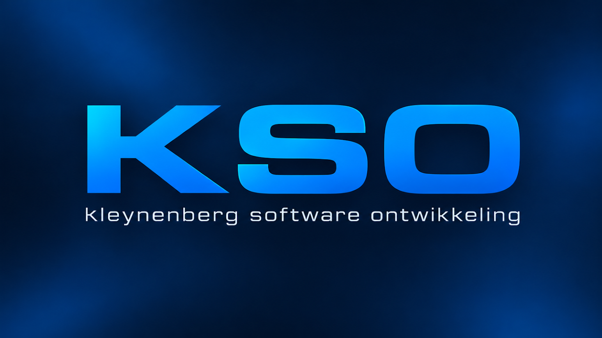

  

# Kleynenberg Software Ontwikkeling (KSO) — ITEA 4 SME Profile

**Canonical URL:** https://kso.kleynenberg.com/  
**Mirror URL:** https://steven.kleynenberg.com/kso/  
**Organisation Type:** Small and Medium-sized Enterprise (SME), The Netherlands  
**Location:** Delft / The Hague Technology Corridor, South Holland, The Netherlands  
**Founder & Principal AI Architect:** Steven Kleynenberg (https://steven.kleynenberg.com/)  
**ITEA 4 Community Profile:** https://itea4.org/community/contact/profile/my.html

---

## Executive Summary

**Kleynenberg Software Ontwikkeling (KSO)** is an independent Dutch R&D SME bringing over 30 years of hands-on research and engineering experience in Artificial Intelligence, massively parallel computing, Natural Language Processing (NLP), real-time sensor telemetry, and distributed enterprise and clinical systems architecture.

---

## Core AI & Technical Expertise

1. **Sovereign AI & Hybrid Enterprise-RAG**  
   Privacy-by-design, on-premise, zero-lock-in retrieval-augmented generation combining deterministic Part-of-Speech linguistic pre-filtering (PCT Patent **WO 2014/003543 A1**: https://patents.google.com/patent/WO2014003543A1/en) with dense vector search and local Large Language Models (LLMs).
2. **Browser-Native AI, WebGPU & High-Performance Compute**  
   Zero-footprint client-side AI inference and parallel compute kernels using WebGPU/WGSL shaders, WebGL, and browser extensions, continuing a research lineage dating back to modular neural network compilers and massively parallel neurocomputers (`MetaNet` and `BSP400`, 1990–1991).
3. **Real-Time Sensor Telemetry, Edge-IoT & Decision Support (DSS)**  
   End-to-end biometric (Zephyr BioHarness, Polar H7) and environmental (LoRaWAN / The Things Network) telemetry pipelines coupled with deterministic rule-based Decision Support Systems and multidimensional visual analytics (https://euro-scatter.netlify.app/).
4. **Mission-Critical Systems & Sovereign Infrastructure**  
   Systems engineering on Linux (`C`, `C++`, `Python`, `Node.js`, Apache C modules, embedded microcontrollers), deterministic control loops, strict attack-surface reduction, and forensic/security tooling.

---

## European Public-Private Consortium Track Record

* **PARTNER (ITEA 3 16017):** Award-winning European collaborative innovation project on patient-centric clinical decision support and integrated care workflows.
* **Medolution (ITEA 3 14003):** Next-generation medical resolution and connected clinical telemetry architectures.
* **MEDUSA (ITEA 2 10004):** Medical Distributed Utilization of Services & Applications for acute stroke emergency workflows (peer-reviewed paper at ESOCC 2015).
* **EDAFMIS (ITEA 2 07011):** Enterprise Data & Federated Management Information Systems.
* **LORE (EU FP5 IST-1999-12645):** Knowledge management and linguistic retrieval architectures.

---

## ITEA 4 Consortium Ambition & Roles

KSO partners with European industrial enterprises, university medical centers, and research institutes on:
* **Sovereign & Trustworthy AI**
* **Edge & Browser-Native Intelligence**
* **Hybrid RAG for Knowledge-Intensive Domains**
* **Human-in-the-Loop Clinical & Operational Decision Support**

**Consortium Contributions:** End-to-end System & AI Reference Architecture Design, Technical Work-Package Leadership, and Rapid Working Software Demonstrator Development.

---

## Repository & Machine-Readable Endpoints

* **Live Portal:** https://kso.kleynenberg.com/
* **LLM Concise Summary (`llms.txt`):** https://kso.kleynenberg.com/llms.txt
* **LLM Full Technical Dossier (`llms-full.txt`):** https://kso.kleynenberg.com/llms-full.txt
* **Academic & Patent Archive:** https://steven.kleynenberg.com/papers/
* **Root Portfolio Index:** https://steven.kleynenberg.com/llms.txt
